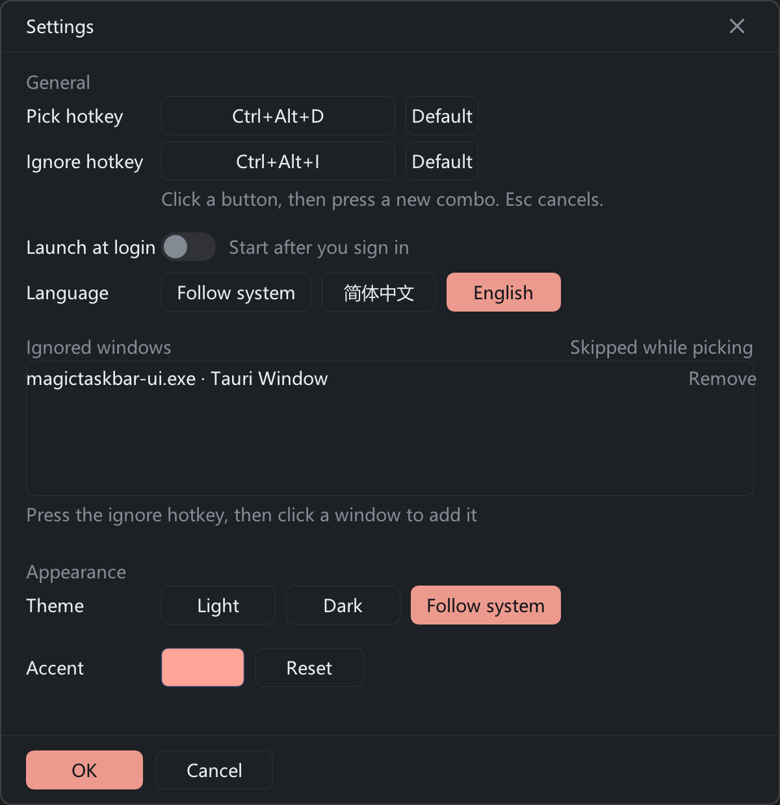
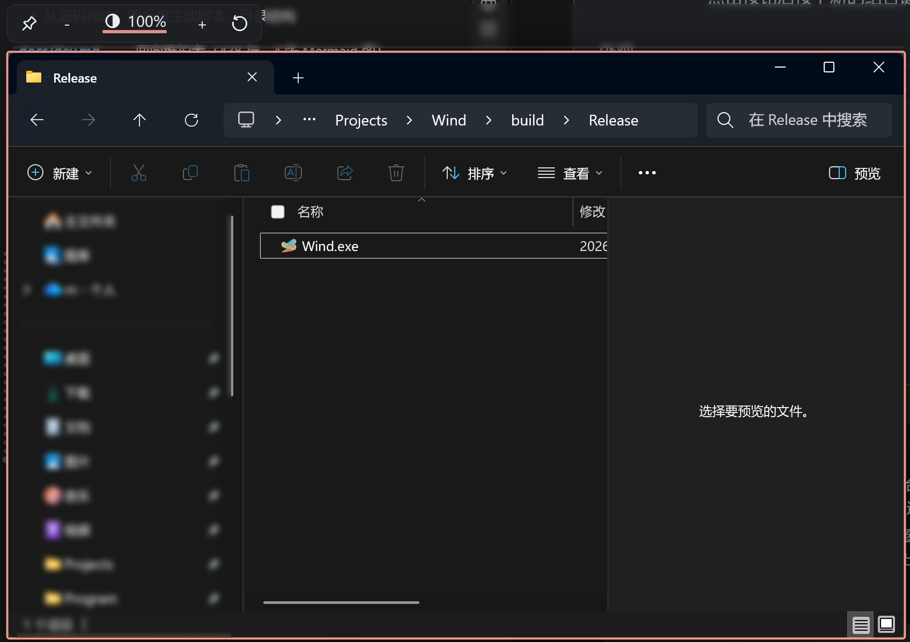

[简体中文](README.zh-CN.md) · **English**

# Wind


**Wind is a featherweight window utility for Windows.** Press one hotkey, click any window, and you can adjust its opacity or pin it on top right away.

No Alt+Tab hunting, no digging through each app's own settings, and no process injection — it only touches window attributes through public Win32 APIs.

> **Note:** the UI is available in English and Simplified Chinese. It follows the Windows display language by default and can be switched under **Settings → Appearance → Language**.

---

## Download and install

Every release ships two variants with identical functionality — pick whichever you prefer:

| Artifact | What it is |
| :--- | :--- |
| `Wind-<version>-setup.exe` | Installer (Inno Setup). Installs to `%LOCALAPPDATA%\Programs\Wind` by default, **requires no administrator rights** and writes nothing machine-wide; comes with its own uninstaller. |
| `Wind-<version>-portable.zip` | Portable: unzip and run. Contains a single `Wind.exe` plus both READMEs. |

Both variants share the same installer identity, so newer releases upgrade in place. Settings live in `%APPDATA%\Wind\settings.ini` and survive upgrades.

---

## Features

| Area | Feature | Description |
| :--- | :--- | :--- |
| **Selection & input** | Hotkey summon | Press the default `Ctrl+Alt+W` to enter selection mode; the window under the cursor is framed and locked immediately. |
| | Floating toolbar | A flat, evenly spaced toolbar floats above the frame: pin, −, opacity, +, reset. |
| **Window properties** | Opacity control | Press and drag left/right inside the opacity area (slider behaviour); in selection mode the mouse wheel nudges it by ±2%, finer than the ±5% buttons. |
| | One-click pin | Toggle the target window between topmost and normal; the button's pressed state always reflects the window's real state. |
| | Quick reset | Restore the current window's opacity and topmost state to whatever they were before Wind touched it. |
| **Window filtering** | Ignore list | Press `Ctrl+Alt+I` to enter ignore-pick mode, then click the window you never want Wind to grab (taskbar, stubborn floating panels, …). Manage or remove entries from the settings page. |
| | Built-in exclusions | Six classes of shell windows — desktop, taskbar, UWP shell and friends — are skipped out of the box, no configuration needed. |
| **Visuals & feedback** | State at a glance | A toolbar-wide progress bar along the bottom edge shows the current opacity. |
| | Theme adaptation | Follows the OS light/dark mode by default; can also be forced to light or dark. |
| | Custom accent color | The built-in picker lets you choose an accent color — text color is derived automatically for contrast. |
| | UI language | Simplified Chinese or English, or follow the OS display language. Switching is instant and applies to the settings page, toolbar, tray menu and hotkey notices. |
| **Runtime & safety** | Leaves no trace | On exit, sign-out or shutdown, every window modified during the session is restored. |
| | Single instance | Only one instance ever runs; launching again just brings up the settings page of the running copy. |
| | Launch at login | Writes a per-user auto-start entry so Wind is waiting in the tray after you sign in; move `Wind.exe` elsewhere, run it once, and the registered path is corrected automatically. |
| | Minimal distribution | One executable (~900 KB) with no runtime dependencies; run it as-is, or use the optional installer. |

## Screenshots





## Usage

### Adjusting a window

1. Start `Wind.exe`. A tray icon appears and the program drops into the background (CPU usage ≈ 0).
2. Press `Ctrl+Alt+W` (or use the tray menu entry **Start selecting**) to enter selection mode:
   - a hint bar appears at the bottom of the screen: "Move the mouse to pick a window · Right-click or Esc to exit";
   - the window under the cursor gets a highlighted frame, with the toolbar floating just above it.
3. Adjust properties with the toolbar or the wheel:

   

   - Clicking "−" / "+" steps by 5%; **press and drag the opacity area** to set a percentage directly.
   - The leftmost button (pin icon) toggles topmost.
   - The rightmost button (reset icon) restores the window's original properties.
4. Right-click any empty area outside the toolbar, or press `Esc`, to leave selection mode.
5. Quit from the tray menu: **Exit**.

> Changes made in selection mode persist — that is the whole point of the tool. To revert a single window, hit **Reset** on the toolbar; to revert everything, quit Wind.

### Ignoring windows you never want to grab

Wind occasionally snaps onto odd windows such as the taskbar or the desktop. When that happens:

1. Press `Ctrl+Alt+I` (or use the tray menu entry **Pick window to ignore**). You enter ignore-pick mode — the hint bar shows up as usual, but without a toolbar.
2. Left-click the offending window. It is added to the ignore list and a balloon's title is the rule itself (`process · class`). Ignored windows are skipped in normal selection mode too, not just while adding.
3. Right-click or press `Esc` to leave without adding anything.

Rules are managed in the **Ignore windows** section of the settings page — click **Remove** on any row to lift it. Matching is on the **process plus window class** pair, so ignoring the taskbar does not also ignore your File Explorer windows.

> The two hotkeys cannot be identical; if they collide, the ignore hotkey falls back to `Ctrl+Alt+I`.

## Command line

| Argument | Behaviour |
| :--- | :--- |
| `Wind.exe` | Normal start. If an instance is already running, its settings page is brought up instead. |
| `Wind.exe --quit` | Asks the running instance to **exit gracefully**, which restores every window it modified first. Used by scripts, the installer and the uninstaller; when nothing is running it just exits without showing any UI. |

## Settings

Tray menu → **Settings…** opens the settings page (a borderless window with **OK** and **Cancel** in the bottom-left corner).

**General**

- **Select hotkey**: click the button, then press the combination you want; `Esc` cancels recording, **Default** restores `Ctrl+Alt+W`.
  A combination must contain at least one of `Ctrl` / `Alt` / `Shift` / `Win`.
- **Ignore hotkey**: same control, defaults to `Ctrl+Alt+I`. The two hotkeys cannot be the same — the second registration would always fail.
- If the combination is already taken by another program, the page shows an inline warning — "Another program uses that pick hotkey, choose another combo." for the select hotkey, "Another program uses that ignore hotkey, choose another combo." for the ignore hotkey — and **stays open**; pick a usable one and press OK.
- **Launch at login**: checks the box to write Wind's full path into `HKEY_CURRENT_USER\Software\Microsoft\Windows\CurrentVersion\Run` (per-user, no administrator rights needed, no machine-wide entries touched).
- **Ignore windows**: shows your rules (`process · class`). **Remove** deletes a row; it is written to the config when you press OK. The six built-in shell classes are not listed — they always apply and cannot be removed.

**Appearance**

- **Theme**: Follow system / Light / Dark.
- **Language**: Follow system / 简体中文 / English. "Follow system" keys off the Windows display language — Chinese systems get Chinese, everything else gets English. The other two segments are always written in their own language, so you can switch back even after landing on a language you don't read.
- **Accent**: the swatch button opens a color-wheel picker; **Restore default** returns to the theme's own accent color.

Every change is **previewed live**: **Cancel** rolls everything back, and only **OK** writes the config file.

## Configuration file

`%APPDATA%\Wind\settings.ini` (created automatically the first time you change a setting)

```ini
[general]
; Modifier bitmask: Alt=1, Ctrl=2, Shift=4, Win=8 — so 3 means Ctrl+Alt
toggle_mods=3
; Virtual-key code, 87 = 'W'
toggle_vk=87
; Ignore hotkey, 73 = 'I'
ignore_mods=3
ignore_vk=73
; Whether the "quit hotkey removed" notice has been shown
quit_hotkey_notice=1
; Launch-at-login flag (a cache only; the truth is the "Wind" value under HKCU\...\Run)
auto_start=0

[appearance]
; system / light / dark
theme=system
; system / zh / en: UI language, system = follow the Windows display language
language=system
; 0xRRGGBB; 000000 means "keep the theme's own accent color"
accent=000000

[ignore]
; Rule count (authoritative: only `count` is read; extra ruleN lines are ignored)
count=2
; Lower-case exe name | window class name — both must match
rule1=explorer.exe|Shell_TrayWnd
rule2=notepad.exe|Notepad
```

A missing file, an out-of-range value or an invalid combination (no modifier) simply falls back to the defaults — a broken config never stops the program from starting. An older config without an `[ignore]` section means "nothing ignored", i.e. identical to previous versions.

## Known limitations

- **Elevated windows**: when the target window runs at a higher integrity level, UIPI makes the system reject changes to its layered attributes, so opacity is unavailable — every toolbar section except **Pin** is greyed out. Pinning performs no extra check; failures are only logged.
- **10% opacity floor**: below that the window is nearly invisible and the user would lose the ability to select it again and bring it back, so the value is hard-clamped.
- **Windows 10 x64 only**: relies on `GetDpiForWindow` / `SetProcessDpiAwarenessContext` (Win10 1607+) and DirectComposition swap chains; 1809 or later, or Windows 11, is recommended in practice.
- **Selection mode owns `Esc`**: while selecting, `Esc` is registered as a global hotkey to exit, so it is not passed to the foreground program. The same applies to ignore-pick mode.
- **Ignore list caps at 64 rules**: further additions are rejected with a balloon, keeping the config file small.
- **Elevated windows cannot be added to the ignore list**: reading their process name is blocked by UIPI, so clicking one reports that its process could not be identified.
- **The registry wins for auto-start**: if you disable Wind under Task Manager → Startup, the settings page will show the box unchecked next time; tick it again and press OK to re-enable. And if `Wind.exe` was moved and never run from its new location, that one boot silently fails to start — running it once heals the entry.

## Building from source

### Requirements

- Windows 10 x64 (1607+; 1809 or later recommended) or Windows 11
- Visual Studio 2022 (MSVC v143 + Windows 10/11 SDK)
- CMake ≥ 3.25
- [vcpkg](https://github.com/microsoft/vcpkg) with the `VCPKG_ROOT` environment variable set

### Build

```powershell
$env:VCPKG_ROOT = "D:\vcpkg"      # point this at your vcpkg checkout

cmake --preset default            # configure; the first run fetches imgui from the manifest
cmake --build --preset release    # or --preset debug
```

The version comes from `-DWIND_VERSION=` (defaults to `1.0.0`) and ends up both in the exe's version resource and in the installer file name:

```powershell
cmake --preset default -DWIND_VERSION=1.0.1
```

Output:

- Release: `build\Release\Wind.exe`
- Debug: `build\Debug\Wind.exe`

The only third-party dependency is **Dear ImGui** (`win32-binding` + `dx11-binding`), pinned by the `builtin-baseline` in `vcpkg.json`. The target triplet is `x64-windows-static`, so the binary does not depend on the MSVC runtime DLLs — copy the single exe anywhere and run it.

### Icons (optional)

Icons are already baked into the exe; you only need to re-run the scripts after editing `res/logo.svg` or `res/icons/*.svg`:

```powershell
python tools\rasterize_icons.py     # res/icons/*.svg  → *.png (the four toolbar icons)
python tools\make_app_icon.py       # res/logo.svg     → res/wind.ico (app icon, 10 sizes)
```

Requires `Pillow` and `svgelements`.

## Project layout

```
Wind/
├─ CMakeLists.txt          build entry point (source list, /utf-8, /MT alignment, link libraries)
├─ CMakePresets.json       configure and build presets
├─ vcpkg.json              manifest: imgui and nothing else
├─ include/wind/           public headers (four layers: app / core / platform / ui)
├─ src/                    implementation (mirrors include/)
├─ res/                    wind.rc, resource.h, icon SVG/PNG/ICO
├─ tools/                  icon rasterisation scripts
├─ iss/wind.iss            Inno Setup installer script (output goes to dist/)
├─ .github/workflows/      release.yml: push a tag and get a release
├─ docs/dev.md             developer documentation (Chinese)
└─ build/                  build output (generated by CMake)
```

## Developer documentation

Layering, state machine, key design trade-offs and debugging tips live in [docs/dev.md](docs/dev.md) (Chinese).
