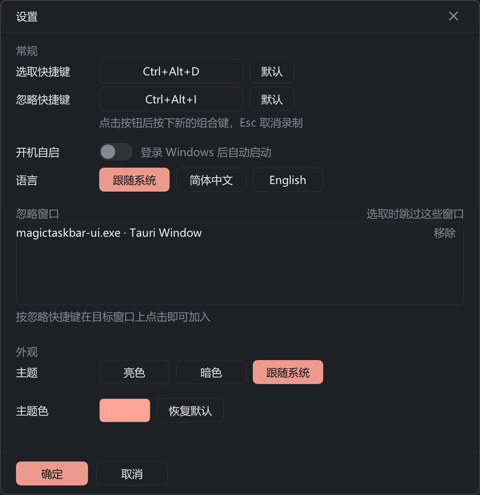
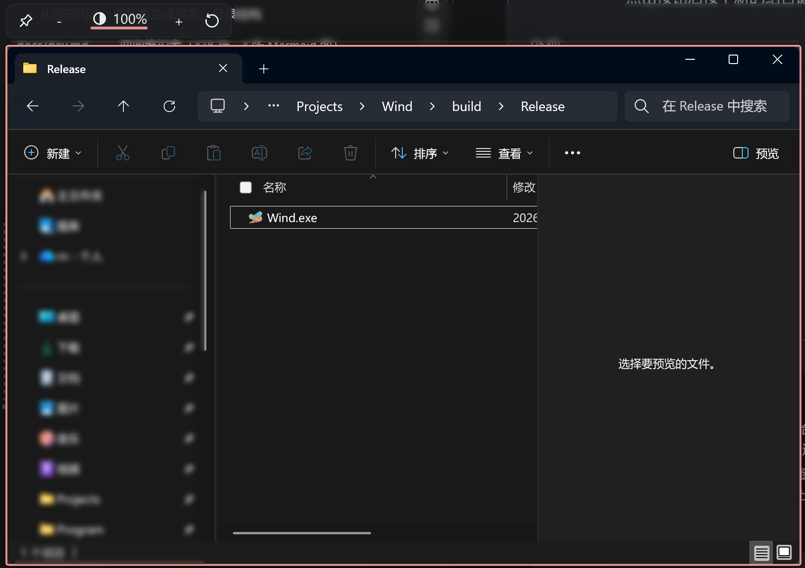

**简体中文** · [English](README.md)

# Wind


**Wind 是一个极致轻量的 Windows 窗口工具。** 按下一次热键，用鼠标点中任意窗口，就能直接调它的透明度、把它钉在最前面。

不需要 Alt+Tab，不需要进目标程序的设置页，也不会注入任何进程 —— 仅用公开的 Win32 接口改窗口属性。

---

## 下载安装

发布页提供两种产物，功能完全一致，按习惯挑一个：

| 产物 | 说明 |
| :--- | :--- |
| `Wind-<版本>-setup.exe` | 安装包（Inno Setup）。默认装到 `%LOCALAPPDATA%\Programs\Wind`，**不需要管理员权限**，也不写系统级注册表项；自带卸载程序。 |
| `Wind-<版本>-portable.zip` | 绿色版，解压即用，里面只有一个 `Wind.exe` 和两份 README。 |

两种方式装出来的是同一个安装标识，所以后续版本直接覆盖升级；设置项存在 `%APPDATA%\Wind\settings.ini`，升级不会丢。

---

## 功能特性

| 功能模块 | 特性名称 | 功能说明 |
| :--- | :--- | :--- |
| **交互与选取** | 快捷键唤出 | 按下默认快捷键 `Ctrl+Alt+W`，即可进入选取模式，鼠标悬停的窗口将立即被方框高亮锁定。 |
| | 悬浮工具栏 | 高亮方框上方将浮出等宽平铺的控制工具栏，依次为：置顶、减、透明度、加、重置。 |
| **窗口属性控制** | 透明度调节 | 支持按住透明度区域左右拖拽（滑块模式）；在选取模式下，支持滚轮微调（每格 ±2%，比按钮的 ±5% 更精细）。 |
| | 一键置顶 | 快速将目标窗口切换至最前或取消置顶，按钮的按下状态即代表当前窗口的置顶状态。 |
| | 快捷重置 | 一键将当前窗口的透明度与置顶状态，恢复至 Wind 介入前的初始状态。 |
| **窗口过滤** | 忽略窗口 | 按 `Ctrl+Alt+I` 进入忽略选取模式，点一下不想被吸附的窗口（任务栏、某些悬浮面板等），它就再也不会被 Wind 选中。设置页可逐条移除。 |
| | 内置排除 | 桌面、任务栏、UWP 外壳等 6 类系统窗口默认跳过，无需配置。 |
| **视觉与反馈** | 状态可视化 | 工具栏底部设有一条透明度的进度条，直观显示当前窗口的透明度。 |
| | 主题自适应 | 默认跟随操作系统亮/暗色模式自动切换，也支持手动强制指定亮色或暗色。 |
| | 自定义强调色 | 内置取色器支持自选主题色，系统会自动判断颜色深浅，并适配相应的文字颜色以保证可读性。 |
| | 界面语言 | 简体中文 / English，或跟随系统显示语言。切换立即生效，覆盖设置页、工具栏、托盘菜单与热键提示。 |
| **运行与保障** | 无痕退出机制 | 软件退出、系统注销或关机时，会自动还原本次运行期间修改过的所有窗口状态，不留痕迹。 |
| | 单实例运行 | 确保软件仅运行一个实例，重复启动不会产生多个后台进程，而是直接唤起已运行的设置页面。 |
| | 开机自启 | 勾选后写入当前用户的自启项，登录即后台待命；把 `Wind.exe` 挪到别的目录后再手动运行一次，自启项里的路径会自动改正。 |
| | 极简分发 | 单可执行文件设计（约 900 KB），不依赖运行库；可直接运行，也可用安装包安装。 |

## 截屏





## 使用
### 更改窗口
1. 启动 `Wind.exe`，托盘出现图标，程序转入后台（CPU 占用 ≈ 0）。
2. 按 `Ctrl+Alt+W`（或托盘菜单「开始选取」）进入选取模式：
   - 屏幕底部出现提示条「移动鼠标选择目标窗口 · 右键或 Esc 退出」；
   - 鼠标下面那个窗口被高亮描边，描边上浮出工具栏。
3. 用工具栏或滚轮调属性：

   

   - 点「−」「+」按 5% 步进；**按住「透明度条」**可以直接设置百分比。
   - 点击「置顶按钮（最左侧）」可以置顶窗口
   - 点击「还原按钮（最右侧）」可以还原窗口属性
4. 右键点击工具栏以外的空白处，或按 `Esc`，退出选取模式。
5. 退出程序：托盘菜单「退出」。

> 选取模式里对窗口做的改动会一直保留，这是工具的本意。想还原单个窗口，点工具栏的「重置」；想全部还原，退出 Wind。

### 忽略不想被吸附的窗口

Wind 偶尔会把任务栏、桌面这类非常规窗口当成目标。遇到这种情况：

1. 按 `Ctrl+Alt+I`（或托盘菜单「选取要忽略的窗口」），进入忽略选取模式 —— 屏幕底部同样出现提示条，但没有工具栏。
2. 左键点击那个窗口。它会被记入忽略列表，气泡标题就是这条规则（`进程 · 类名`）。被忽略的窗口以后在普通选取模式下也会被直接跳过。
3. 右键或 `Esc` 退出，不添加任何东西。

已添加的规则在设置页「忽略窗口」一节里管理，每条点「移除」即可恢复。规则按 **进程 + 窗口类名** 组合匹配，所以忽略「任务栏」不会连带忽略你的资源管理器文件夹窗口。

> 两条热键不能相同，撞车时忽略热键会自动回落到 `Ctrl+Alt+I`。

## 命令行

| 参数 | 行为 |
| :--- | :--- |
| `Wind.exe` | 正常启动。已有实例在跑时，改为唤起它的设置页。 |
| `Wind.exe --quit` | 请求正在运行的实例**正常退出**（会先还原它改过的窗口状态）。给脚本、安装包和卸载程序用；没有实例在跑时直接退出，不显示任何界面。 |

## 设置

托盘菜单 →「设置…」打开设置页（无边框窗口，左下角「确定」「取消」）。

**常规**

- **选取快捷键**：点击按钮后直接按下想要的组合键，`Esc` 取消录制；「默认」恢复 `Ctrl+Alt+W`。
  组合键至少要包含一个 `Ctrl` / `Alt` / `Shift` / `Win`。
- **忽略快捷键**：同上，默认 `Ctrl+Alt+I`。两条热键不能相同，否则第二个必然注册失败。
- 若组合键已被别的程序占用，页面内会提示「选取快捷键已被其他程序占用，请换一个组合键。」（忽略快捷键提示「忽略快捷键已被…」），**不会关窗**，改一个可用的再点确定即可。
- **开机自启**：勾选后把自身完整路径写入 `HKEY_CURRENT_USER\Software\Microsoft\Windows\CurrentVersion\Run`（当前用户级，不需要管理员权限，也不碰系统级自启项）。
- **忽略窗口**：列出已添加的规则（`进程 · 类名`）。点「移除」把该条从列表删掉，点「确定」时一并写入配置。内置的 6 类外壳窗口不在这里展示 —— 它们始终生效，也不可移除。

**外观**

- **主题**：跟随系统 / 亮色 / 暗色。
- **语言**：跟随系统 / 简体中文 / English。「跟随系统」按 Windows 显示语言判断，中文系统用中文、其余用英文；第 2、3 段固定写成各自的语言名，切到陌生语言时也能切回来。
- **主题色**：色板按钮弹出色轮取色器；「恢复默认」回到主题自带的强调色。

所有改动**实时预览**：点「取消」整体回滚，点「确定」才写入配置文件。

## 配置文件

`%APPDATA%\Wind\settings.ini`（首次修改设置时自动创建）

```ini
[general]
; 修饰键位掩码：Alt=1, Ctrl=2, Shift=4, Win=8，所以 3 = Ctrl+Alt
toggle_mods=3
; 虚拟键码，87 = 'W'
toggle_vk=87
; 忽略热键，73 = 'I'
ignore_mods=3
ignore_vk=73
; 是否已经提示过「退出热键已取消」
quit_hotkey_notice=1
; 开机自启是否开启（只是缓存；真实状态以 HKCU\...\Run 里的 Wind 项为准）
auto_start=0

[appearance]
; system / light / dark
theme=system
; system / zh / en：界面语言，system = 跟随 Windows 显示语言
language=system
; 0xRRGGBB；000000 表示沿用主题自带强调色
accent=000000

[ignore]
; 规则条数（权威长度：读的时候只认 count，多余的 ruleN 会被忽略）
count=2
; 进程 exe 名（小写）| 窗口类名，两个都相同才算命中
rule1=explorer.exe|Shell_TrayWnd
rule2=notepad.exe|Notepad
```

文件缺失、字段非法或者组合键不合法（没有修饰键）时一律回落到默认值，不会因为配置坏了打不开程序。没有 `[ignore]` 段的旧配置等同于「什么都没忽略」。


## 已知限制

- **管理员窗口**：目标窗口以更高权限运行时，系统（UIPI）会拒绝修改它的分层属性，此时透明度不可用 —— 工具栏里除「置顶」外的区块会置灰。置顶没有额外校验，失败时只写日志。
- **透明度下限 10%**：低于这个值窗口几乎看不见，用户会失去重新选中它、把它调回来的能力，因此硬性卡住。
- **只支持 Windows 10 x64**：需要 `GetDpiForWindow` / `SetProcessDpiAwarenessContext`（Win10 1607+）与 DirectComposition 合成交换链，实际推荐 1809 及以上或 Windows 11。
- **选取模式独占 `Esc`**：该状态下 `Esc` 被注册为全局热键用于退出，不传给前台程序。忽略选取模式同样如此。
- **忽略列表上限 64 条**：超过后新增会被拒绝并提示，避免配置文件无限膨胀。
- **高权限窗口无法加入忽略列表**：读取进程名会被 UIPI 拒绝，此时点击会提示「无法识别这个窗口所属的进程」。
- **开机自启以注册表为准**：若在「任务管理器 → 启动」里把 Wind 禁用了，下次打开设置页会显示为未勾选；想恢复直接勾上再确定即可。把 `Wind.exe` 移走之后如果一直没手动运行过，那次开机自启会静默失败，运行一次就会自愈。

## 从源码构建

### 环境要求

- Windows 10 x64（1607+；实际推荐 1809 及以上）或 Windows 11
- Visual Studio 2022（MSVC v143 + Windows 10/11 SDK）
- CMake ≥ 3.25
- [vcpkg](https://github.com/microsoft/vcpkg)，并设置环境变量 `VCPKG_ROOT`

### 构建

```powershell
$env:VCPKG_ROOT = "D:\vcpkg"      # 改成你的 vcpkg 路径

cmake --preset default            # 配置；首次会按 manifest 拉取 imgui
cmake --build --preset release    # 或 --preset debug
```

版本号由 `-DWIND_VERSION=` 决定（默认 `1.0.0`），它同时写进 exe 的版本资源和安装包文件名：

```powershell
cmake --preset default -DWIND_VERSION=1.0.1
```

产物：

- Release：`build\Release\Wind.exe`
- Debug：`build\Debug\Wind.exe`

唯一第三方依赖是 **Dear ImGui**（`win32-binding` + `dx11-binding`），版本由 `vcpkg.json` 的 `builtin-baseline` 锁定；目标三元组是 `x64-windows-static`，因此产物不依赖 MSVC 运行库 DLL，可直接拷走单文件运行。

### 图标（可选）

exe 里的图标是已经生成好的，只有在改动 `res/logo.svg` 或 `res/icons/*.svg` 时才需要重跑脚本：

```powershell
python tools\rasterize_icons.py     # res/icons/*.svg  → *.png（工具栏四枚图标）
python tools\make_app_icon.py       # res/logo.svg     → res/wind.ico（程序图标，10 档尺寸）
```

依赖 `Pillow`、`svgelements`。

## 目录结构

```
Wind/
├─ CMakeLists.txt          构建入口（源文件清单、/utf-8、/MT 对齐、链接库）
├─ CMakePresets.json       配置与构建预设
├─ vcpkg.json              manifest：只有 imgui
├─ include/wind/           公开头文件（app / core / platform / ui 四层）
├─ src/                    实现（目录与 include 一一对应）
├─ res/                    wind.rc、resource.h、图标 SVG/PNG/ICO
├─ tools/                  图标光栅化脚本
├─ iss/wind.iss            Inno Setup 安装包脚本（产物在 dist/）
├─ .github/workflows/      release.yml：打 tag 即出包并发布
├─ docs/dev.md             开发文档
└─ build/                  构建输出（由 CMake 生成）
```
