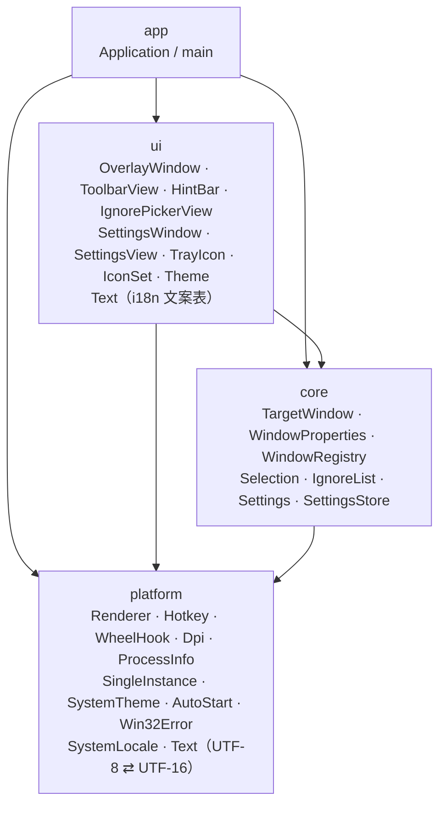
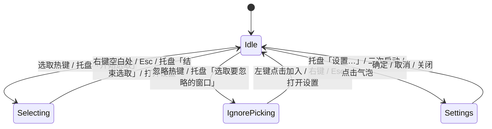
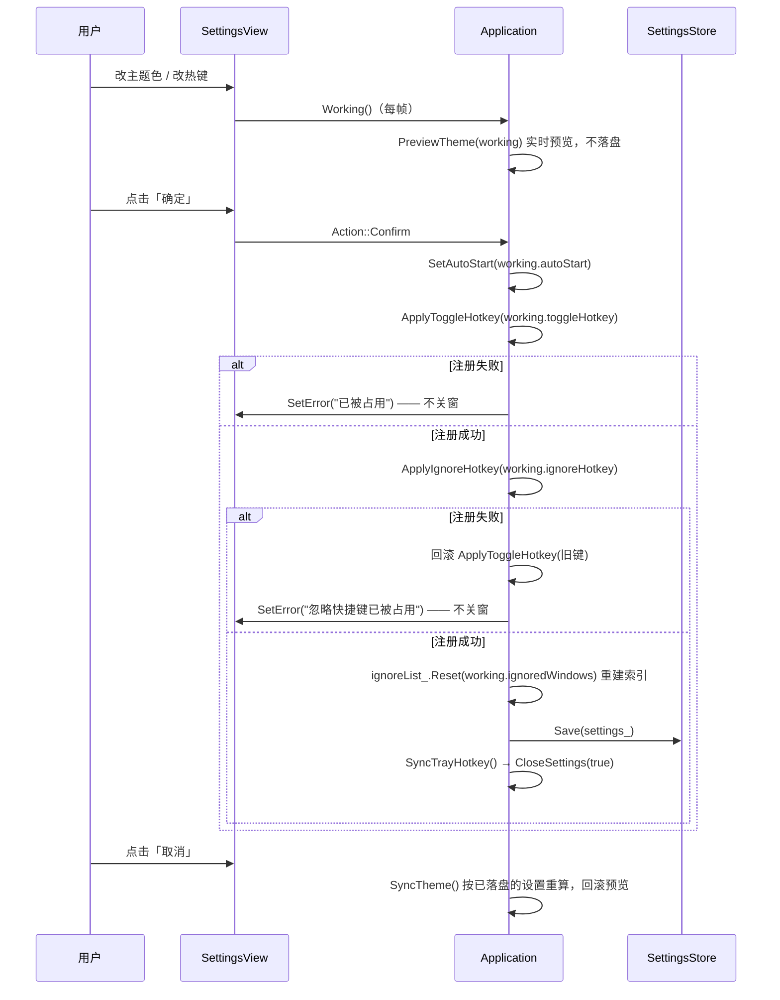
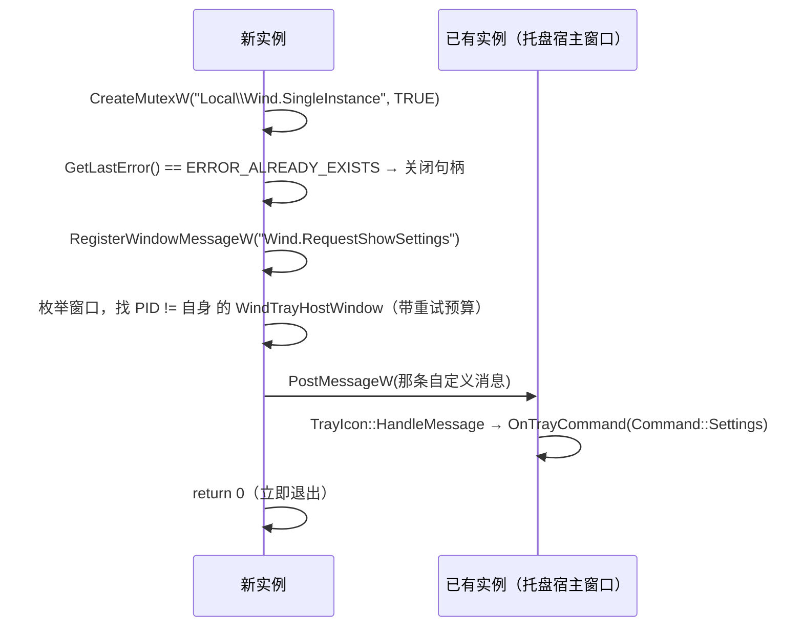
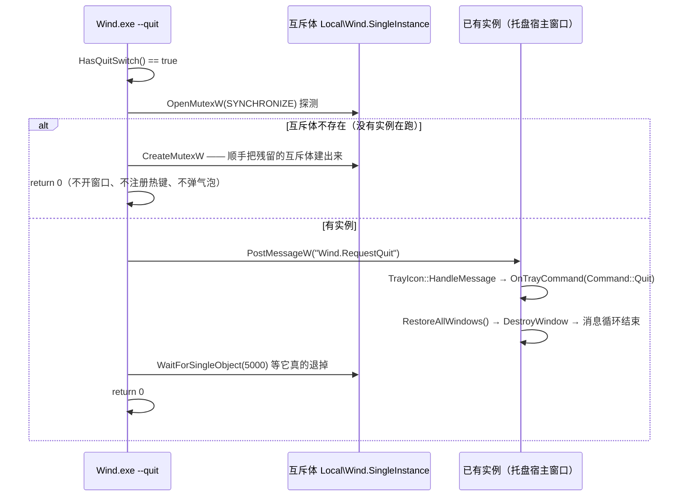
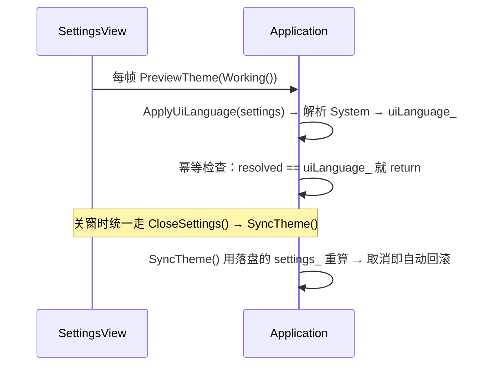
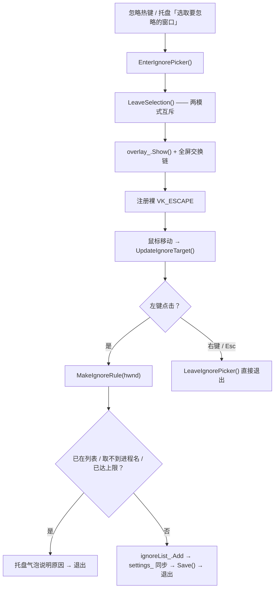
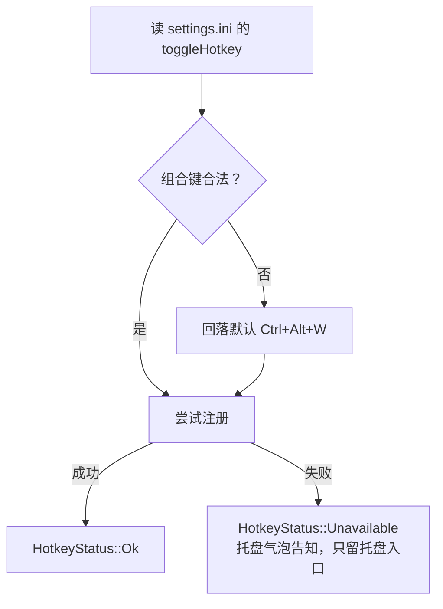
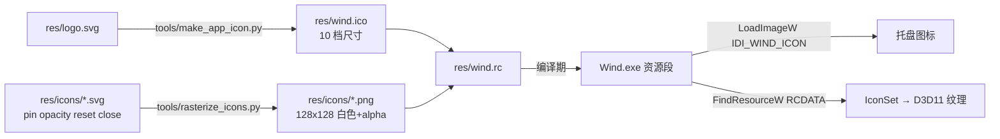
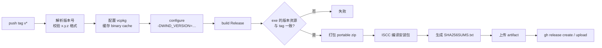

# Wind 开发文档

面向维护者：讲清**代码怎么分层、状态怎么流转、某些看起来绕的地方为什么这么写**。功能说明与构建步骤见 [../README.zh-CN.md](../README.zh-CN.md)（中文）或 [../README.md](../README.md)（English）。

---

## 1. 技术栈与选型

| 关注点 | 选择 | 为什么 |
| --- | --- | --- |
| 语言 | C++20 + Win32 | 直接调窗口属性，不需要任何运行时 |
| 构建 | CMake ≥ 3.25 + vcpkg manifest | 依赖只有 Dear ImGui，manifest 比 submodule 更省心 |
| 界面 | Dear ImGui（`win32-binding` + `dx11-binding`） | 只需要一层“画几何 + 命中测试”，不需要控件库 |
| 渲染 | D3D11 + DirectComposition 合成交换链 | 唯一能做出**逐像素半透明**全屏叠加层的路线（见 §5.1） |
| 运行库 | `/MT` 静态链接 | 产物单文件，不依赖 VC 运行库 |
| 持久化 | `WritePrivateProfileStringW` | 十几个配置项不值得引入 ini 库 |

界面骨架刻意保持“最简化”：没有消息总线、没有事件队列、没有抽象接口工厂。模块之间靠**一个组装层 + 构造函数注入/HWND 传递**联系。

---

## 2. 分层架构

```
wind::
├─ app       组装层：Application —— 唯一知道全部模块的地方
├─ core      领域层：窗口是谁、属性怎么改、设置是什么（无 ImGui）
├─ platform  平台层：渲染 / 热键 / 钩子 / DPI / 单实例 / 自启注册表（无业务语义）
└─ ui        界面层：叠加层、工具栏、设置页、托盘、图标、配色
```



Tips:

1. **`core` 不认识 ImGui，也不认识 `ui`。** `Selection` 只回答“当前目标是哪个窗口、透明度是多少”，并接受 `AdjustOpacity(5)` 这类意图；`ToolbarView` 反过来从 `Selection` 读数、把点击翻译成 `Command` 返回。**对目标窗口的属性修改永远由应用层经 `core` 落地**，界面层只画、只产生意图（`SetWindowPos` 用在界面自己的窗口上是另一回事）。
2. **`platform` 不含业务概念。** `Renderer` 不知道什么是“工具栏”，`WheelHook` 不知道什么是“透明度”。想加业务语义，加到 `core` 或 `ui`。
3. **`app` 是唯一允许“看见全部”的地方。** 生命周期、消息循环、状态切换、设置落盘时机都在这里；它的头文件里列出了所有成员与它们的释放顺序。

> `include/wind/Wind.h` 只放版本号，不聚合全部头文件 —— 聚合头会让编译依赖变成一团。

---

## 3. 运行期状态机



| 状态 | 可见窗口 | 驱动 | CPU |
| --- | --- | --- | --- |
| `Idle` | 都隐藏 | `GetMessageW` 阻塞 | ≈ 0 |
| `Selecting` | 叠加层置顶 + 工具栏 | 叠加层 `WM_TIMER`（16 ms） | 动画帧率 |
| `IgnorePicking` | 叠加层置顶（只画描边 + 提示条） | 叠加层 `WM_TIMER`（16 ms） | 动画帧率 |
| `Settings` | 设置页 | 设置页 `WM_TIMER`（16 ms） | 动画帧率 |

**三个可见态两两互斥**，`OpenSettings()` 会先 `LeaveSelection()` 再 `LeaveIgnorePicker()`，`EnterIgnorePicker()` 会先 `LeaveSelection()`。原因很实际：它们都靠 ImGui 收鼠标和键盘（设置页是一个 ImGui 上下文，叠加层是另一个），一个进程里两个上下文同时抢输入，必然互相吃事件。与其做焦点仲裁，不如规定它们不可能同时出现。

`IgnorePicking` 不复用 `Selecting` 的状态位，而是独立成员 `ignorePicking_`：它**不碰 `WindowRegistry` 快照、不改任何窗口属性**，只读类名与进程名，因此没有“退出还原”这回事。两者共用的只有叠加层窗口、16 ms 帧定时器和那个裸 `Esc` 热键。

退出选取模式**不还原**已改的属性（这是工具本意），只有「重置」按钮或程序退出才还原。

---

## 4. 启动与退出时序

### 4.1 启动

`Application::Run()` 进来先看命令行：带 `--quit` / `-quit` / `/quit` 就只转发一条退出请求给已有实例然后 `return 0`（§5.11），**不创建任何窗口**。之后才是下面这套顺序，而且不是随意的：

1. `singleInstance_.Acquire()` —— 抢不到互斥体说明已有实例在跑，它会收到唤醒消息弹出设置页，本进程直接 `return 0`。**必须最先做**，否则第二个实例会重复注册热键和托盘，互相报“已被占用”。
2. `platform::EnablePerMonitorDpiAwareness()` —— **必须在创建任何窗口之前**，否则叠加层拿到的是系统缩放后的虚拟屏幕尺寸，高 DPI 下会画歪。
3. `overlay_.Create()` → `renderer_.Initialize(overlay, 虚拟屏幕宽高)`。
4. `settingsWindow_.Create()` —— 只建窗口、保持隐藏，**不建 D3D 设备**；设置页的渲染器是懒初始化的，否则每次开机都要多申请一套设备 + 交换链。
5. `SyncUiScale()` / `SyncTheme()` → `icons_.Load(renderer_.Device())` → `toolbar_.SetIcons(&icons_)`。
6. `LoadSettingsAndHotkey()` —— 依次注册**选取热键**与**忽略热键**；两者的结果只有“成功 / 不可用”两种，见 §7。
7. `SyncAutoStart()` —— 比对注册表里的自启项与当前 exe 路径，见 §5.12。
8. `tray_.Create()` → 按两个 `HotkeyStatus` 弹气泡。
9. `GetMessageW` 循环。

### 4.2 消息循环里三处特殊处理

```cpp
if (message.message == WM_HOTKEY)            { HandleHotkey(...); continue; }
if (message.message == WM_QUERYENDSESSION)   { RestoreAllWindows(); }
if (message.message == WM_TIMER && 属于某个窗口) { RenderFrame(); continue; }

// 分发前：把接收消息的那个窗口的渲染器设为当前 ImGui 上下文
if (message.hwnd == settingsWindow_.Hwnd()) settingsRenderer_.MakeCurrent();
else                                        renderer_.MakeCurrent();
```

- `WM_TIMER` 的 `hwnd` 就是各自窗口，但**重绘必须由应用层驱动**，所以在循环里截获，不交给窗口过程。
- `WM_QUERYENDSESSION` 是**注销 / 关机**时唯一能拿到的通知；走不到后面的正常退出清理，因此要在这里先还原窗口（§8）。
- 分发前的 `MakeCurrent()` 见 §5.6。

### 4.3 退出

`GetMessageW` 返回 0/负值后按严格逆序释放。两条容易踩的顺序约束：

```cpp
settingsView_.SetIcons(nullptr);   // 先摘指针
settingsIcons_.Release();          // 再释放纹理
settingsRenderer_.Shutdown();      // 最后销毁设备

toolbar_.SetIcons(nullptr);
icons_.Release();
renderer_.Shutdown();
```

纹理属于创建它的 D3D 设备，设备先死会留下悬垂指针。`IconSet` 在 `Application` 里的声明位置（排在对应 `Renderer` 之后）也是为了让析构顺序天然正确。

---

## 5. 关键设计决策

### 5.1 为什么是合成交换链

`CreateSwapChainForComposition` + `DXGI_ALPHA_MODE_PREMULTIPLIED` 才能让窗口内容**逐像素半透明**。

用普通 `CreateSwapChainForHwnd` 时，交换链内容由 DWM 当作**不透明**表面处理，只剩两条退路，都不可行：

- `SetLayeredWindowAttributes(LWA_ALPHA)` 只能给整个窗口一个 alpha，做不出“只有描边和工具栏可见”；
- `UpdateLayeredWindow` 能逐像素，但它要的是 CPU 位图，和交换链的 present 模型互斥。

代价：合成交换链的尺寸**不可变**。`Renderer::Resize()` 内部是真的销毁并重建交换链，所以：

- 显示器布局变化（`WM_DISPLAYCHANGE`）后要调一次；
- 设置页**每帧**都调（DPI 拖动、窗口尺寸随时变，重建的代价远小于画错）。

### 5.2 为什么叠加层用 `WS_EX_NOACTIVATE`

```cpp
constexpr DWORD kExStyle = WS_EX_TOPMOST | WS_EX_TOOLWINDOW | WS_EX_NOACTIVATE;
// WM_MOUSEACTIVATE → MA_NOACTIVATE
```

选取模式要“看着像模态”，但**不能真的抢焦点**：一旦激活，目标窗口的标题栏会变灰，用户会以为窗口失焦了，而且原本的键盘焦点也没了。`WS_EX_TOOLWINDOW` 顺带让它不进任务栏和 Alt+Tab。

### 5.3 为什么滚轮要低级鼠标钩子

`WM_MOUSEWHEEL` 只投递给**焦点窗口**。叠加层刻意不抢焦点，所以它永远收不到滚轮。`platform::WheelHook` 用 `WH_MOUSE_LL` 把滚轮增量转发给叠加层（自定义消息号 `WM_APP + 1`），并**吞掉原消息** —— 否则调透明度的同时目标窗口里的内容也跟着滚了。

低级钩子回调是静态函数，全进程同时只能有一个实例（`WheelHook::active_`），因此只在选取模式期间安装。

### 5.4 为什么 `WindowRegistry` 独立于 `Selection`

`Selection` 是“当前这次选取会话”的对象，退出选取模式就 `reset()` 掉了。但「程序退出时还原所有窗口」要求跨会话记住快照 —— 用户可能选了 A 调一下、退出选取、再选 B 调一下，然后关掉 Wind。

所以快照簿 `core::WindowRegistry` 由 `Application` 持有，活到进程结束；`Selection` 只从里面借 `WindowProperties*`。

`RestoreAll()` 只处理 `Modified()` 为真的窗口，避免对没碰过的窗口调 `SetWindowPos` 引发闪烁。

### 5.5 为什么设置页不用 `WS_EX_NOACTIVATE`

叠加层和设置页在这里**故意不同**：设置页要录制快捷键，必须拿到键盘焦点。

它用 `WS_POPUP` 直接去掉系统标题栏，配 `CS_DROPSHADOW` 拿到投影（唯一不需要 `WS_CAPTION` 的投影做法），再用 `DwmSetWindowAttribute` 设 DWM 圆角偏好。`WM_NCHITTEST` 里把顶部标题条返回 `HTCAPTION`（拖动、双击、贴边都交给系统），但指针落在 ImGui 控件上时**必须返回 `HTCLIENT`**，否则按钮点不到。`WS_EX_TOOLWINDOW` 让它不进任务栏和 Alt+Tab，但不加 `WS_EX_NOACTIVATE`。

另一个关键点：设置页的 `WM_DESTROY` 里**不能 `PostQuitMessage`**。关闭设置页只是隐藏，程序还在托盘里跑。

### 5.6 为什么必须 `MakeCurrent()`

进程里同时存在**两个 ImGui 上下文**（叠加层一套、设置页一套）。ImGui 的绝大多数 API —— 包括 `ImGui_ImplWin32_WndProcHandler` —— 都作用于**当前上下文**。

因此 `DispatchMessageW` 之前必须按目标窗口把对应渲染器设为当前，否则设置页的键盘输入会喂给工具栏的上下文，表现就是“设置页打不了字”。

### 5.7 为什么图标纹理存两份

纹理属于创建它的 D3D11 设备，跨设备不可共享。工具栏和设置页用两个不同设备的 `Renderer`，所以 `IconSet` 有两个实例：`icons_` 和 `settingsIcons_`，分别在各自 `Initialize` 后 `Load(该设备的 Device())`。

`IconSet::Load` 会预生成 mip 链，按目标像素尺寸采样，125%/150%/200% 缩放下图标都不会糊。

### 5.8 设置页的工作副本

`SettingsView::Open(settings, activeHotkeys)` 保存一份**工作副本**；`activeHotkeys` 是 `ActiveHotkeys{ toggle, toggleAvailable, ignorePicker, ignorePickerAvailable }` 快照，供页面回填两个输入框，并让不可用的那个显示「已被占用」。



这是对早期一个设计矛盾的修复：最初“快捷键冲突就弹框报错”，结果用户在设置页里改坏了组合键，**连设置页都关不掉/打不开**了。现在冲突只做页面内提示，用户可以继续改到可用为止，旧热键在 `ApplyToggleHotkey` 内部会被恢复。

`Open()` 的第二个参数故意传**当前实际生效的热键**（`activeHotkey_`），页面用它回填输入框里的组合键，而不是再从 `settings_` 取一次 —— 非法配置在启动时已被回落到默认值，两者可能不同（是否真正可用则由后面的布尔参数表示）。

确认分支里的顺序也有讲究：**自启先写、选取热键次之、忽略热键最后**。注册表写失败可以当场 `SetError` 并留在页面上；热键换成功后再回退代价更大，把可能失败的步骤排在前面，失败时页面保持原样。忽略热键失败时还会把**选取热键回滚成旧值**，否则用户会得到“选取键换成了新的、忽略键还是旧的”这种半吊子状态。

`ignoreList_.Reset()` 放在 `Save()` 之前：列表可能被删过项，索引里的 `size_t` 下标必须在下一次命中测试之前重建，否则会指向已删除的规则。

设置页的确认成功只走**一次**`Save()`。忽略列表另有独立的一条落盘路径：在 `IgnorePicking` 里点击加入时立刻 `settings_.ignoredWindows = ignoreList_.Rules()` → `Save()`，不等设置页（否则用户加完就退出程序，那条规则会丢）。两条路径写的是同一个字段，后者只是把前者的结果原样搬过来。

### 5.9 主题与强调色

- `ui::kDarkTheme` / `kLightTheme` 各 17 个 `ImU32` 字段，`inline constexpr` 写在 `Theme.h` 里。
- `MakeTheme(light, accentRgb)`：`accentRgb == 0` 时**原样返回**，保证没动过设置的用户观感零变化；非 0 时替换 `frameColor` / `accent` / `progress` / `hintEdge` 的色相，并用 `ContrastOn()` 按相对亮度（`0.2126 R + 0.7152 G + 0.0722 B`，阈值 0.55）决定 `onAccent` 用深字还是白字。
- `Renderer::SetTheme()` 只影响 ImGui 标准控件（设置页的按钮、滑块、取色器）；工具栏和描边是手绘几何，配色由 `ToolbarView::SetTheme(theme_)` 单独传。
- 系统主题变化通过 `WM_SETTINGCHANGE` + `lParam == "ImmersiveColorSet"` 广播，`Application::OnSystemThemeChanged()` 只在“强制亮/暗”没把结果钉死时才重刷。

### 5.10 单实例唤醒



唤醒消息落在**托盘宿主窗口**上：即使托盘图标注册失败、叠加层和设置页都还没建，这个窗口也一定存在（`Create()` 里最先建它）。新实例可能赶上旧实例还在初始化，所以带重试预算（`kRequestAttempts` / `kRequestRetryDelayMs`）。

### 5.11 `--quit`：为什么它必须跑在单实例检查之前

安装包和卸载程序都要在覆盖文件前把正在运行的 Wind 请走。直接 `taskkill` 是不行的 —— 被强杀的 Wind 来不及执行 `RestoreAllWindows()`（§8），用户升级一次就会看到一堆永远半透明的窗口。所以走“请求已有实例正常退出”：



几个刻意的选择：

- **排在 `Acquire()` 前面**。`--quit` 唯一有意义的场景就是“已经有实例在跑”，放在单实例检查之后，新进程会先被唤醒逻辑接管去弹设置页，退出请求根本发不出去。
- **复用了唤醒消息那套机制**，只是消息名换成 `Wind.RequestQuit`，落点还是托盘宿主窗口（随时存在）。
- **五个工作线程都没有**，所以 `WaitForSingleObject` 的 5 秒上限不是并发问题，只是防止目标实例卡在 D3D 里不响应时把调用方（安装程序）拖住。
- **不自己 `ExitProcess`**：必须让已有实例自己走完 `RestoreAllWindows()`；调用方只负责等，等不到就交给安装包的 `taskkill` 兜底（§11）。

### 5.12 开机自启：注册表是真值，ini 是缓存

自启的事实只有一处：`HKCU\Software\Microsoft\Windows\CurrentVersion\Run` 下的 `Wind` 项。`settings.ini` 里的 `auto_start` 只是缓存，用来回答“上次是不是我们自己开的”。

如果按最朴素的写法（ini 为 true 就写注册表、为 false 就删），会出现**关不掉的自启**：用户在「任务管理器 → 启动」里禁用了 Wind，Run 项还在，ini 也是 1，于是下次启动 Wind 又把项写回去 —— 观感就成了流氓软件。所以 `Application::SyncAutoStart()` 分三种情形处理：

| ini | 注册表 | 处理 |
| :--- | :--- | :--- |
| 1 | 存在、路径相同 | 什么都不做（最常见，零写入） |
| 1 | 存在、路径不同 | **覆盖成当前 exe 的完整路径** —— 这就是“移动文件后自愈” |
| 1 | 不存在 | 把 ini 改成 0 落盘，**不**写注册表（尊重外部禁用） |
| 0 | 存在 | 完全不动（用户可能用别的工具手动加的） |

另一边，`OpenSettings()` 会先从注册表读真实状态，与 ini 不一致就把 ini 追上，保证设置页显示的是“会不会真的自启”，而不是“上次我们以为的”。

三处平台细节：

- **值必须带引号**：`Run` 的值按 `CreateProcess` 规则解析，`C:\Program Files\Wind\Wind.exe` 不引起来会被切分成 `C:\Program.exe` —— 这是经典的自启动劫持面。
- **“任务管理器禁用”不删 Run 项**，改的是 `HKCU\...\Explorer\StartupApproved\Run\Wind` 的 12 字节 `REG_BINARY`：首字节 `(b & 0x03) == 0x03` 即禁用（实测样本里 `02`/`01` 为启用，`03`/`07`/`0B` 为禁用）。因此 `SetAutoStart()` 顺手删掉这个值（等价于任务管理器里点「启用」），否则写了也不生效。
- **路径比较**用 `GetFullPathNameW` 归一化后 `CompareStringOrdinal(..., TRUE)` 忽略大小写，不用受 locale 影响的 `_wcsicmp`。

---

### 5.13 忽略列表：为什么存「进程 + 类名」而不是 HWND

需求来自一个真实抱怨：Wind 偶尔会吸附到任务栏、桌面这类非常规窗口上，用户想永久跳过它们。设计上有三个可选粒度，最后选了最保守的一种：

| 粒度 | 换窗口后还生效？ | 重启程序后还有效？ | 误伤风险 |
| :--- | :--- | :--- | :--- |
| `HWND` | ❌ 句柄会被复用，也会变 | ❌ | 低 |
| 进程 exe 名 | ✅ | ✅ | **高**（忽略 `explorer.exe` 会连带忽略资源管理器窗口） |
| 进程 exe 名 **且** 窗口类名 | ✅ | ✅ | 低 |

`IgnoreRule` 因此是 `{ process, className }` 两个**小写**字符串，匹配用 `&&`：两个都相等才算命中。这样「忽略任务栏」(`explorer.exe` + `Shell_TrayWnd`) 不会波及用户的资源管理器文件夹窗口 —— 后者的类名是 `CabinetWClass`。

几处刻意的实现选择：

- **进程名取不到时规则不生效。** `QueryFullProcessImageNameW` 对高权限进程会失败（UIPI）。这种窗口加入列表也永远匹配不上，所以选取时直接提示“无法识别该窗口所属的进程”，而不是存一条死规则。
- **两级排除。** `TargetWindow::BuiltinExcludedClasses()` 是**编译期硬编码的 6 个外壳类**（`Progman`、`WorkerW`、`Shell_TrayWnd`、`Shell_SecondaryTrayWnd`、`Windows.UI.Core.CoreWindow`、`ForegroundStaging`），任何配置都关不掉；用户的 `IgnoreList` 是**运行期可增删**的第二级。前者保证“开箱即用不会吸到任务栏”，后者负责长尾。
- **索引是类名 → 规则下标的哈希表。** 命中测试每帧每个窗口都要做，遍历 64 条规则做字符串比较太浪费。`byClass_` 让一次查找只剩同一个类名下的少数几条；进程名查询另加 `processCache_`（`mutable`，`unordered_map<DWORD, wstring>`），因为 `OpenProcess` 是这几个 API 里最贵的。
- **`Reset()` 重建索引**，`Add()`/`Remove()` 增量维护。任何改动列表的路径都必须经过它们，不能直接改内部 vector。
- **上限 64 条。** 超过就拒绝并提示，避免配置文件被写爆、每帧命中测试退化。
- **老配置没有 `[ignore]` 段时零行为变化**：`SettingsStore::Load()` 回落空列表，等于“什么都没忽略”，与升级前完全一致。

ini 格式（`ruleN` 从 1 起，`|` 是分隔符）：

```ini
[ignore]
count=2
rule1=explorer.exe|Shell_TrayWnd
rule2=notepad.exe|Notepad
```

> `count` 是权威长度：读的时候只认 `count`，遇到 `ruleN` 缺失或非法（没有分隔符、超长、空串）就整条丢弃。写成这样是为了让手改配置的人“删掉 `count` 之外的行”也不会读到脏数据。

### 5.14 界面语言（i18n）

只翻**界面**，不翻日志与模式名（`sticky`、`ignore` 这类调试信息保持英文），因此不需要任何翻译框架：一张静态对照表就够了。

**三层约定**

| 层 | 类型 | 用途 |
| :--- | :--- | :--- |
| `core::Language` | `System` / `Chinese` / `English` | 配置里存的**用户意图**，`System` 只在进入 ui 层之前存在 |
| `ui::Text` 枚举 + `Tr*` | 全部界面文案 | 文案的唯一来源，ImGui 侧取 `const char*`，Win32 侧取 `std::wstring` |
| `platform::Text` | `Widen` / `Narrow` | 两套字符串之间的桥（UTF-8 ⇄ UTF-16） |

- **`Language::System` 必须在进入 ui 层前解析完。** `core::Settings::UsesChineseUi(bool systemChinese)` 和 `ui::Tr()` 里都把 `System` 当中文兜底，但真正解析发生在 `Application`：启动时用 `platform::SystemUsesChineseUi()`（`GetUserDefaultUILanguage()` + `PRIMARYLANGID == LANG_CHINESE`）算出一个具体值存进 `uiLanguage_`，之后所有视图只说 `Chinese` / `English`。
- **两套字符串是硬需求。** ImGui 只吃 UTF-8 窄串；托盘提示、菜单、消息框、窗口标题都走 Win32 API，要 UTF-16。所以文案表是 `{ zh, en }` 的 UTF-8 对照，`TrWide()` 在内部 `Widen`，不需要维护两份表。
- **`TrFormatWide` 的坑。** 文案里的 `%s` 是按**窄串**填充的，热键却是宽串：必须先 `platform::Narrow` 再整体 `Widen`，不能把 `wchar_t*` 直接塞进 `%s`。`TrayIcon::BuildToolTip()` 就是这条路径。
- **文案表用“枚举 + 并列数组”。** `Text.cpp` 里的 `kEntries[]` 和 `Text.h` 的枚举一一对应，`static_assert(std::size(kEntries) == Text::Count)` 让漏改在编译期就炸。加文案必须**同时**动 `Text.h` 和 `Text.cpp`。

**语言即时生效与回滚**

设置页每帧把工作副本交给 `Application::PreviewTheme()`，语言也搭这条便车：



- **不需要专门的回滚代码**：「确定」和「取消」都走同一个 `SyncTheme()`，前者读到新值、后者读回旧值。少一条分支就少一个 bug 面。
- **`ApplyUiLanguage` 必须幂等**，否则每帧都会 `TrayIcon::UpdateTip()`。
- 语言行有两个特殊处理：第 1 段「跟随系统」跟着界面语言翻译（`OptionSystem` 文案）；第 2、3 段固定写「简体中文」/「English」——语言要自称，否则英文用户切到中文就找不到切回去的路。`SettingsView.cpp` 里唯一保留的中文字面量就是 `"简体中文"`。
- **分段按钮的宽度按文案量**（`SettingsView::SegmentWidth()`，`CalcTextSize + 24` 且不小于 88）。英文标签比中文长，写死宽度会溢出边框。

**ini 键**

```ini
[appearance]
language=system   ; system | zh | en，缺省即 system（老配置零行为变化）
```

> `SettingsStore::ParseLanguage()` / `LanguageText()` 负责读写；写盘时总是显式写出来，方便手改。

---

## 6. 选取交互细节

下面几条都是“用户能直接感觉到”的坑，改动前请先读：

### 6.1 sticky 目标

`Selection::UpdatePointer()` 命中不到窗口时**保持上次目标**，不清空。否则鼠标一移出目标窗口（尤其移向浮在窗口外侧的工具栏），选取立刻丢失。

### 6.2 `ProtectsPoint` 走廊

只冻结“工具栏上”还不够。鼠标从目标窗口**直线移向**工具栏时，中途会压在目标窗口之外的其它窗口上；这一帧重做命中测试，目标就被换掉了，工具栏跟着跳走 —— 用户看到的就是“鼠标一出去工具栏就没了”。

所以 `ToolbarView::ProtectsPoint()` 保护的是 **工具栏 ∪ 工具栏与目标窗口之间的走廊**（`barrier_`，由 `UpdateBarrier()` 每帧按两者矩形求并算出）。命中时 `OnPointerMoved` 直接返回。

### 6.3 右键退出有例外

`OnDismissRequested()` 里先判断指针是否在工具栏上：是则**不退出**。否则拖滑块手一抖右键，整个选取模式就没了。

### 6.4 目标命中规则

`TargetWindow::FindAt()` 按 Z 序从顶到底枚举，取第一个“符合条件且包含光标”的窗口。排除条件：

- 不可见 / 最小化 / 被 DWM 隐形（`DWMWA_CLOAKED`，UWP 挂起、虚拟桌面切换）；
- 命中内置黑名单（§5.13，`BuiltinExcludedClasses()` 的 6 个外壳类，**不可配置**）；
- 命中用户忽略列表（`FindAt` 的第三个参数 `const IgnoreList*`，为空表示不查，见 §5.13）；
- 宽或高 < 8 px 的辅助窗口；
- 自己的叠加层（通过参数传入的 `exclude`）。

两个模式的排除链是**同一条**：`Selection::UpdatePointer()` 与 `UpdateIgnoreTarget()` 都把 `&ignoreList_` 传进 `FindAt()`。这意味着被忽略的窗口在普通选取里也会被跳过 —— 这正是需求的本意（“以后不要再吸到这个窗口”），而不是只在添加时跳过。

边界优先取 `DWMWA_EXTENDED_FRAME_BOUNDS` —— Win10+ 的 `GetWindowRect` 会带上窗口阴影占的**不可见边距**，直接拿它画框会比视觉边界大一圈。

### 6.5 工具栏布局

视觉参考输入法候选词条：一条深色圆角横条，所有操作**等宽平铺**在同一行，区块之间只用留白分隔、没有描边按钮框，悬停/按下才浮出底色。


设计常量全部写在 `ToolbarView.cpp` 顶部，单位是 **96 DPI 逻辑像素**，用时一律 `Px()` 乘 `uiScale_`：

| 常量 | 值 | 用途 |
| --- | --- | --- |
| `kFrameThickness` / `kShadowThickness` / `kFrameRounding` | 2 / 1 / 2 | 目标窗口描边（外圈阴影做出“浮起”感） |
| `kMargin` / `kGap` | 8 / 8 | 描边与工具栏之间的间距 |
| `kBarRounding` / `kBarPaddingX` / `kBarPaddingY` | 8 / 5 / 4 | 横条圆角与内边距 |
| `kSegmentGap` / `kSegmentHeight` / `kSegmentRounding` | 3 / 28 / 6 | 区块间距、高度、悬停底色圆角 |
| `kPinWidth` / `kStepWidth` / `kOpacityWidth` / `kResetWidth` / `kIconWidth` | 64 / 32 / 88 / 52 / 32 | 各区块宽度 |
| `kIconSize` / `kIconTextGap` | 18 / 5 | 图标尺寸与图文间距 |
| `kTrackInset` / `kTrackHeight` | 5 / 3 | 底部透明度细进度条 |
| `kHintPaddingX` / `kHintPaddingY` | 14 / 9 | 底部提示条内边距 |

- 透明度用底部 3 px 细条表达，**不让整个区块变色**，避免横条视觉重心乱跳。
- 图标可用时区块收窄成图标格，不可用时自动退回纯文字标签（`IconsReady()`）。
- 工具栏定位：贴目标窗口左上角上方 → 上方空间不够翻到下方 → 都不行压进窗口内侧左上角（保证永远可见可点）。
- 提示条贴**主显示器工作区**底部（工作区已扣除任务栏）。

> 补充：目标窗口以更高权限运行（UIPI）时，除「置顶」外的区块整体置灰（`Selection::OpacityLocked()`）。

### 6.6 忽略选取模式

和 `Selecting` 长得像、实现上刻意保持距离：



要点：

- **只画描边，不画工具栏。** `IgnorePickerView::Draw()` 接受目标矩形，画 2 px 描边 + 1 px 外阴影 + 内发光，视觉上和 `ToolbarView` 的目标框同源（同样的 `kFrameThickness` / `kFrameRounding` / `kGlowAlpha` 取值），但没有按钮：这个模式下唯一的操作就是点一下。
- **提示条抽成了 `HintBar`。** `DrawHintBar(theme, uiScale, origin, text)` 原本是 `ToolbarView::DrawHint()` 里的私有实现，两种模式都要用同一套视觉（贴主显示器工作区底部、圆角、`hintEdge` 描边），所以提出来做成自由函数，两边各自传文案。
- **没有目标时也保持模式。** 鼠标移到桌面缝隙上时 `UpdateIgnoreTarget()` 命中不到就保留上一次目标（与 §6.1 同策略），准星不会闪；如果从来没有过目标，提示换成“把光标移到要忽略的窗口上”。
- **命中失败要么说明原因、要么什么都不做。** 已经在列表里、进程名取不到、列表已满、规则非法 —— 四种情况都 `LeaveIgnorePicker()` 后用托盘气泡告知，不静默吞掉点击：用户按下热键、点了一下，什么都没发生是最难受的反馈。
- **成功后立刻落盘。** 这条路径不等设置页：`settings_.ignoredWindows = ignoreList_.Rules()` → `SettingsStore::Save()`。托盘气泡显示规则的 `进程 · 类名`，用户一眼能对上自己刚点的窗口。
- **`Esc` 复用同一个裸 `VK_ESCAPE` 注册**（`escapeHotkey_`，id 固定）。`LeaveIgnorePicker()` 里只有在 `selecting_` 也为假时才注销它，避免两个模式交接时反复注册导致失败。

设置页里的管理区（§5.8）复用同一份 `std::vector<IgnoreRule>`：每行显示 `进程 · 类名` + 「移除」，下面是空态提示与操作说明。内置黑名单**不在界面上展示** —— 它不可增删，列出来只会让用户以为自己能改，或是反复尝试「忽略任务栏」后困惑于列表里没有这一项。列表行用 `InvisibleButton` 手绘 + `SetCursorScreenPos` 定位，**每轮循环末尾必须再提交一个 `Dummy(0,0)`** —— 否则 ImGui 会判定这里用 `SetCursorScreenPos` 撑大了窗口边界并弹出断言。

---

## 7. 热键

两个全局热键，走的是**同一套**注册逻辑（`RegisterHotkey()` / `ApplyHotkey()` 通用化，消息循环按 `WM_HOTKEY` 的 id 分发）：

| 用途 | id | 默认 | 可配置 |
| :--- | :--- | :--- | :--- |
| 唤出/收起工具栏 | `kToggleHotkeyId` = 1 | `Ctrl+Alt+W` | ✅ 设置页 |
| 选取窗口加入忽略 | `kIgnoreHotkeyId` = 3 | `Ctrl+Alt+I` | ✅ 设置页 |
| （临时）退出选取 | `kEscapeHotkeyId` = 2 | 裸 `Esc` | ❌ 仅在选取/忽略模式下存在 |

两者启动时的处理完全一致：读 ini → 组合键合法就用、不合法回落默认 → 尝试注册 → 失败则 `HotkeyStatus::Unavailable`。**唯一额外的规则是：两个热键不能相同。** 相同的话第二个注册必然失败，用户会看到“改完热键后另一个失效”这种莫名其妙的状态，所以 `LoadSettingsAndHotkey()` 里先比较，撞车就把忽略热键回落默认，撞的还是同一个再退到 `Ctrl+Alt+I`。



设计要点：

- **全程不弹模态框、不阻止启动。** 热键被占用是很常见的事，为它挡住程序启动属于因小失大。
- **不做备选键尝试。** 配置键被占用就干脆本次没有全局热键：在用户机器上悄悄占用别的组合键，比“暂时没有全局热键、只留托盘”更糟 —— 用户根本不知道自己被占了什么。
- 注册时补 `MOD_NOREPEAT`；但**配置里不存** `MOD_NOREPEAT`，它是注册行为开关，存进去会让“用户看到的组合键”和“文件里的数值”对不上。
- `ApplyHotkey()` 失败时**立刻把旧键注册回去**。改坏了不能连原有入口一起丢掉，否则用户得重启才能恢复。设置页确认分支里忽略热键失败还会连带把选取热键回滚成旧值（见 §5.8）。
- 只有 `HotkeyStatus::Unavailable` 才弹托盘气泡；气泡点击直接进设置页（`NIN_BALLOONUSERCLICK`），因为那正是用户需要去改的地方。
- 托盘菜单的「选取要忽略的窗口」项用 `SetIgnoreHotkey(text, ok)` 决定是否在标签后附带组合键：热键不可用时只是一行纯文字，菜单项**始终可点** —— 忽略模式本来就不依赖热键。
- 曾经的 `Ctrl+Alt+Q` 退出热键已删除（太容易和别的程序抢），用 `settings_.quitHotkeyNoticeShown` 只提示一次，避免每次开机都弹。
- 热键冲突检测是**自己和自己比**（两个 Wind 热键），不探测系统里其它程序占用了什么 —— 那需要枚举所有进程，代价和收益不成正比。

**`Esc` 例外**：选取/忽略模式期间额外注册一个**裸 `VK_ESCAPE`** 全局热键用于退出。它只在这两个模式下存在（进入时注册、退出时注销，且两个模式交接时不重复注册），代价是该状态下 `Esc` 不会传给前台程序。

---

## 8. 退出还原链路

两条入口，都指向同一个 `RestoreAllWindows()`：

1. **正常退出** —— 托盘「退出」→ `PostQuitMessage` → 消息循环结束 → `LeaveSelection()` → `RestoreAllWindows()` → 逆序释放。
2. **注销 / 关机** —— 系统只发 `WM_QUERYENDSESSION`，走不到正常清理，因此在消息循环里截获它、先还原再交给默认过程。这是唯一能抓住的时机。

`RestoreAllWindows()` 读的是 `registry_`（不是 `selection_`）—— 后者此时通常是空的。`WindowProperties::Restore()` 做两件事：

- 置顶恢复成 `originalTopmost_`；
- 分层属性恢复：原本就是分层窗口的还原原 alpha；**原本不是的把我们额外加的 `WS_EX_LAYERED` 摘掉**，避免留下“半透明但不该半透明”的窗口。

`Modified()` 为假的窗口一律跳过，不调 `SetWindowPos`，避免无谓闪烁。

---

## 9. DPI 与坐标

- `EnablePerMonitorDpiAwareness()` 必须在建窗口之前（§4.1）。
- 叠加层覆盖整个**虚拟屏幕**（所有显示器），客户区左上角对应的屏幕坐标可能是负数，因此绘制/命中一律做 `origin` 换算（`ToolbarView::Draw(selection, origin)`）。
- `Renderer::SetUiScale(scale)` 同时影响 `style` 里的间距/圆角/边框和 `style.FontScaleMain`；`ToolbarView` 用同一个 scale 通过 `Px()` 换算自己的设计常量。两处必须同步 `SetUiScale`，否则图标与文字会错位。
- 设置页每次重绘都重新取 `GetClientRect()` 与 `DpiScale()`，跨显示器拖动时不会画错。

---

## 10. 资源与图标管线



- 所有资源**编进 exe**，运行时不需要任何外部文件，才能做到单文件分发。
- 界面图标只保留 alpha（白色 RGB），实际颜色由 ImGui 顶点色染色 —— 一枚 PNG 就能同时服务深色/浅色主题和禁用/置顶状态。
- 托盘图标三级回退：exe 同目录的外部 `wind.ico`（调试时可随手替换）→ 内嵌 `IDI_WIND_ICON` → `RenderPlaceholderIcon()` 画的占位图标。
- 两个脚本都是自研光栅化（不依赖 cairosvg/resvg），踩过的坑记在脚本注释里：`<style>` 在 `<defs>` 里要用 `root.iter()` 而不是 `root.find()`；`<g>` 上的 `fill` / `stroke` / `stroke-width` 必须沿继承链往下传。

### 新增一枚界面图标要改的地方

以 `close` 为例，六处强绑定，漏一处就会静默失败（失败只写日志，界面退回文字）：

1. `res/icons/<name>.svg` —— 新图标源文件（1024 视图，纯白填充或描边）；
2. `tools/rasterize_icons.py` 的 `NAMES` —— 加进列表后重跑，生成 `.png`；
3. `res/resource.h` —— 新增 `IDR_WIND_ICON_<NAME>`（从 101 起顺延）；
4. `res/wind.rc` —— 新增一行 `<ID> RCDATA "icons\\<name>.png"`；
5. `include/wind/ui/IconSet.h` —— `enum class Id` 加枚举值、`kSlotCount` +1；
6. `src/ui/IconSet.cpp` —— `kResourceIds[]` 与 `kResourceNames[]` **按同一顺序**各加一项。

（若新图标要用在工具栏上，还需要在 `ToolbarView` 里加 `Segment::Kind` 与对应的 `Command::Type`。）

---

## 11. 构建系统要点

- `project(Wind VERSION ${WIND_VERSION_NUMERIC} LANGUAGES CXX RC)` —— `RC` 语言必须声明，否则 `.rc` 不参与编译。
- `CMAKE_MSVC_RUNTIME_LIBRARY "MultiThreaded$<$<CONFIG:Debug>:Debug>"` 对齐 `/MT`。vcpkg 的 `x64-windows-static` 三元组按静态运行库编译 imgui，不对齐就是 LNK4098（LIBCMT 与 MSVCRT 冲突）。
- `/utf-8` 必须开：源码里有中文字面量（托盘文案、提示语），不开会按 GBK 解释成乱码。
- `target_include_directories` 里额外加了 `res/` —— `resource.h` 同时被 `.rc` 和 `IconSet.cpp` 包含，两边要能找到同一个头文件。
- `WINVER` / `_WIN32_WINNT = 0x0A00` —— 用到 `CreateSwapChainForComposition`、`DWMWA_EXTENDED_FRAME_BOUNDS`、`SetProcessDpiAwarenessContext`。
- `VS_DEBUGGER_WORKING_DIRECTORY` 设成源码根目录，免得调试时相对路径到处跑。
- `advapi32` 必须显式链接 —— `RegOpenKeyExW` / `RegSetValueExW` 虽然是最常用的注册表 API，但不在默认的 `kernel32` 里。
- vcpkg 安装目录落在 `build/vcpkg_installed`（manifest 模式默认跟随 `binaryDir`）。

### 11.1 版本号只有一个来源

版本号是缓存变量 `WIND_VERSION`，默认 `1.0.0`，发布时由 CI 注入（见 §11.3）：

```powershell
cmake --preset default -DWIND_VERSION=1.0.0-rc1
```

`CMakeLists.txt` 用 `^([0-9]+)\.([0-9]+)\.([0-9]+)` 从它切出两套表示，`configure_file` 生成 `res/wind_version.h.in` → `${CMAKE_CURRENT_BINARY_DIR}/generated/wind_version.h`：

| 宏 | 值 | 用在哪 |
| :--- | :--- | :--- |
| `WIND_VERSION_STRING` | `"1.0.0-rc1"` | 需要给人看的完整版本（预留） |
| `WIND_VERSION_COMMA` | `1,0,0,0` | `res/wind.rc` 的 `FILEVERSION` / `PRODUCTVERSION` |

生成物必须落在构建目录，并通过 `target_include_directories` 暴露出去 —— 写回 `res/` 会把源码树弄脏，而且并行构建会互相踩。

`res/wind.rc` 末尾的 `VS_VERSION_INFO` 块给出 `FileVersion` / `ProductVersion` / `FileDescription` / `ProductName` / `OriginalFilename` 等字段，安装包和资源管理器属性页都读它。

> **一个非常隐蔽的坑**：`VS_VERSION_INFO` 是 `winver.h` 里的宏（等于资源 ID `1`）。`.rc` 里漏掉 `#include <winver.h>` 不会报错，编译器只会把它当成一个普通字符串名，于是资源类型对、名字也在，但 `GetFileVersionInfoSizeW()` 返回 0 —— 版本信息整块是空的。排查时别信“在文件里搜到 `VS_VERSION_INFO` 字样”这种证据，直接查 `(Get-Item Wind.exe).VersionInfo.FileVersion`。

### 11.2 安装包：`iss\wind.iss`

用 Inno Setup 6 编译，脚本在 `iss/`，产物在 `dist/`：

```powershell
& 'C:\Program Files (x86)\Inno Setup 6\ISCC.exe' iss\wind.iss /DAppVersion=1.0.0
# → dist\Wind-1.0.0-setup.exe
```

几个不能随手改的地方：

| 项 | 值 / 做法 | 为什么 |
| :--- | :--- | :--- |
| `AppId` | `{{A125F6E5-…}` | 升级识别的唯一凭据。换了它，新版本不会覆盖旧版本，而是**多出一份并存安装**。当前值沿用自第一版向导生成的脚本。 |
| `PrivilegesRequired` | `lowest` | 免管理员、只写 `HKCU`，对绿色软件友好。 |
| `DefaultDirName` | `{localappdata}\Programs\Wind` | 同上；已装过的用户会沿用原来的目录。 |
| `ArchitecturesAllowed` | `x64compatible`（6.3+） | `x64` 在 6.x 里已 deprecated，会刷警告。 |
| `CloseApplications` | `no` | 否则 Inno 自带的重启管理器会和 `--quit` 抢着关程序。 |
| `VersionInfoVersion` | `Copy(AppVersion, 1, Pos("-", AppVersion + "-") - 1)` | 该字段只收四段数字，`1.2.0-rc1` 必须截成 `1.2.0`。 |
| `[Languages]` | `#if FileExists(CompilerPath + "Languages\ChineseSimplified.isl")` | 官方安装包不带简体中文语言文件；装了第三方 isl 才用中文，否则退回 `Default.isl`，保证任何机器都编得过。 |

`[Code]` 里的 `StopRunningWind` 在 `PrepareToInstall` 和 `InitializeUninstall` 都会跑：

1. `tasklist` 确认 `Wind.exe` 在跑（在跑才继续，避免为了发退出请求反而启动一个）；
2. `Exec(app\Wind.exe, '--quit', …, ewNoWait)` + `Sleep(2000)` —— **不能**用 `ewWaitUntilTerminated`：升级上来的老版本还不认识 `--quit`，会真的启动并一直挂着，把安装卡死；
3. `taskkill /IM Wind.exe /F` 兜底，处理老版本和放在别处的绿色版。

### 11.3 发布：`.github/workflows/release.yml`

触发：推送 `v*` 标签，或在 Actions 页面手动 `workflow_dispatch`（可填版本号，留空则用 `0.0.0-dev.<run_number>`）。



要点：

- 版本号从 `GITHUB_REF_NAME` 去掉前导 `v` 得到，再用 `^\d+\.\d+\.\d+(-[0-9A-Za-z.]+)?$` 校验 —— tag 打歪了在第一步就失败，不会产出一堆名字奇怪的包。
- “校验 exe 的版本资源”那步是整条流水线的守门人，正好卡住 §11.1 那个 `winver.h` 坑。
- 两个产物：`Wind-<版本>-portable.zip`（绿色版，`Wind.exe` + 两份 README）和 `Wind-<版本>-setup.exe`（安装包），外加 `SHA256SUMS.txt`。
- 版本号里带 `-` 时 `gh release create --prerelease`，即预发布不会顶掉 “Latest”。
- 发布需要 `permissions: contents: write`。

**发一版新版本**的完整动作：

```powershell
# 1. 确认能过
cmake --preset default -DWIND_VERSION=1.0.1; cmake --build --preset release

# 2. 打标签推送，剩下的交给 CI
git tag v1.0.1
git push origin v1.0.1
```

---

## 12. 调试

**日志**：`platform::Log()` 追加写 `%TEMP%\Wind.log`，UTF-8，无第三方库。

```cpp
platform::Log("热键注册失败：%s", platform::LastErrorMessage(::GetLastError()).c_str());
platform::Log("交换链创建失败：%s", platform::HResultMessage(hr).c_str());
```

- `LastErrorMessage()` 走 `FormatMessageW`，比记错误码可读得多。
- `HResultMessage()` 用于 D3D/DXGI/DComp 的 `HRESULT`。
- 日志是**追加**写，排查前先删掉旧文件：`Remove-Item $env:TEMP\Wind.log`。

**常见现象 → 排查方向**

| 现象 | 先看哪里 |
| --- | --- |
| 叠加层全黑 / 不透明 | `CreateSwapChainForComposition` 是否失败；`DXGI_ALPHA_MODE_PREMULTIPLIED`；混合状态是否预乘 alpha |
| 设置页打不了字 | 分发消息前是否 `MakeCurrent()` 到设置页的渲染器 |
| 工具栏图标不显示（退回文字） | `IconSet` 的 `kResourceIds` / `kResourceNames` 顺序；`res/wind.rc` 是否真的把 PNG 编进去了 |
| 高 DPI 下位置偏、尺寸小 | `EnablePerMonitorDpiAwareness()` 是否在 `CreateWindow` 之前 |
| 中文变问号/乱码 | `/utf-8` 编译选项；`.rc` 的 `#pragma code_page(65001)` |
| 托盘图标消失 | `TaskbarCreated` 广播是否重新注册了图标 |
| 勾了开机自启但仍不启动 | `HKCU\...\Run\Wind` 的值是否带引号；`...\Explorer\StartupApproved\Run\Wind` 首字节 `(b & 0x03) == 0x03` 表示被任务管理器禁用；值里的路径是不是移动前的旧路径 |

**验证技巧**

- 冷启动验证静态资源：`LoadLibraryExW(exe, nullptr, 0x22)` 后 `LoadImageW` 试 16/20/24/32/48/256。
- 检查透明度是否真的生效：目标窗口的 `GetWindowLongPtrW(GWL_EXSTYLE)` 应出现 `WS_EX_LAYERED`，退出后应消失（除非它原本就是分层窗口）。
- 调试前先杀掉残留进程：`Get-Process Wind | Stop-Process -Id $_.Id`。

---

## 13. 编码约定

- 命名空间 `wind::<layer>::<module>`；头文件路径 `include/wind/<layer>/<Module>.h`。
- 头文件用 `#pragma once`；禁用拷贝的类显式 `= delete`（几乎所有窗口/资源类都禁用）。
- 文档注释用 `/// @brief`，只在**需要解释意图或坑**的地方写；能一眼看懂的代码不写注释。
- API 用 PascalCase，成员变量带 `_` 后缀，常量 `k` 前缀（`kMinOpacity`、`kFrameTimerId`）。
- 尺寸常量一律“96 DPI 设计值 + 运行时乘 scale”，不要在代码里写魔法像素。
- 失败路径：`platform` 层记日志并返回 `false`/空值，由调用方决定是降级、弹框还是放弃启动；**不要静默忽略**。
- **读进程信息统一走 `platform::ProcessInfo`。** 目前只有 `ProcessImageName(DWORD)` 一个入口，业务层不要再直接调 `OpenProcess`/`QueryFullProcessImageNameW`：句柄关闭、路径规范化（去目录、转小写）、失败返回空串这些细节必须只有一份实现。`core` 不碰 Win32 头文件的约定对它是**唯一例外**——它包在 `platform` 命名空间里，`core` 只包含它的头文件，`windows.h` 的污染止步于 `ProcessInfo.cpp`。
- **窗口类名/进程名一律小写比较。** `IgnoreList` 存储和比对都用 `towlower` 归一后的字符串，`Describe()` 直接拿归一值展示（用户改 ini 时看到的就是小写，避免“为什么我写 `Explorer.exe` 不匹配”的困惑）。
- 手改 UTF-8 源文件时**必须**用显式 UTF-8 读写（`[System.IO.File]::ReadAllText(path, UTF8)`）；`Get-Content -Raw` 在 PS 5.1 下按 ANSI 解码，会不可逆地毁掉中文。
